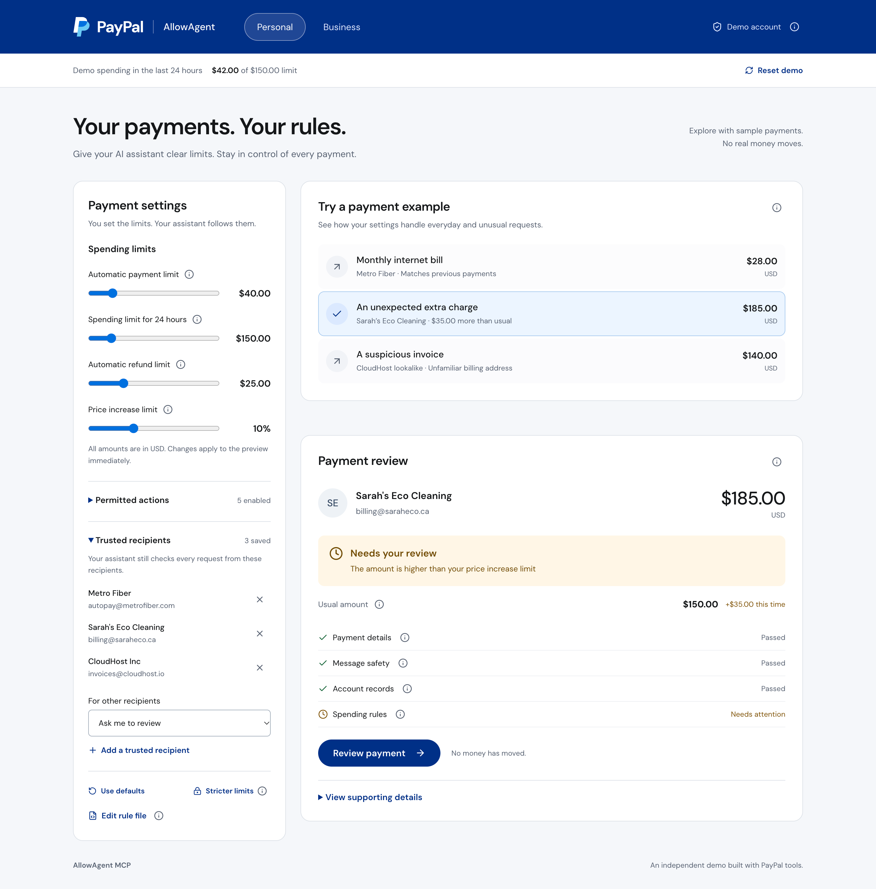

# AllowAgent MCP

[](https://github.com/poferraz/allowagent-mcp/actions/workflows/ci.yml)
[](LICENSE)

**Your payments. Your rules.** A payment-control demo that shows how an AI assistant
can follow spending limits, check account records, and ask before taking an unusual action.

Built for the [PayPal AI Hackathon](https://paypalaihackathon.devpost.com/).
Independent prototype; not an official PayPal product.



## Run locally

Requires **Node.js 22** and npm. No API keys or PayPal account are needed.

```bash
git clone https://github.com/poferraz/allowagent-mcp.git
cd allowagent-mcp
npm ci
npm run dev
```

Open the local URL printed by Vite (usually `http://localhost:5173`). For a production
preview, run `npm run build`, then `npx vite preview`.

## Try the demo

1. Choose **Personal** or **Business** to load sample settings and requests.
2. Select a payment example. Selection only previews the request; it never executes it.
3. Read the recipient, amount, decision, and checks. Use the info buttons for brief explanations.
4. For an eligible request, choose the displayed action. For an unusual request, choose
   **Review payment** to compare amounts, approve, adjust where supported, or decline.
5. Use **Reset demo** to restore the sample account records. Settings remain as configured.

| Example | Default result |
| --- | --- |
| Monthly internet bill · $28 | Ready to pay |
| An unexpected extra charge · $185 vs. $150 usual amount | Review the invoice-payment record |
| A suspicious invoice · $140 | Blocked |
| A shipping delay refund · $24 | Ready to refund |
| A disputed delivery · $320 | Blocked |
| A contractor payment · $420 | Review the invoice-payment record |

Results change with the selected rules. Recording an invoice payment is distinct from
sending a payment. All actions update the in-memory demo ledger; **no real money moves**.

## How it works

`PAYPAL.md` is a readable rule file for payment permissions. The demo applies four checks:

- **Payment details:** validate arguments and the referenced account resource.
- **Message safety:** flag configured suspicious instruction patterns in request and account text.
- **Account records:** compare the request with sample invoices, orders, delivery records, and history.
- **Spending rules:** enforce permitted actions, trusted recipients, and amount limits.

The implementation separates pure evaluation from execution. Only positively verified
requests can qualify for automatic execution, malformed rules fail closed, and execution
uses a recomputed request digest with one-time approval consumption. Technical evidence
is available under **View supporting details → Developer details**.

## Dual-Mode Architecture & AI Agent

AllowAgent MCP bridges autonomous AI agents with PayPal spending tools through a deterministic, fail-closed firewall.

1. **AI Agent Tool-Calling:** Type any natural language prompt (e.g. *"Pay Sarah's Eco Cleaning invoice for $185"*) into the top **AI Payment Assistant** bar. The agent analyzes financial intent and emits `@paypal/agent-toolkit` tool calls.
   - Built-in Local Financial Reasoner (zero API keys required).
   - Live Google Gemini 2.5 Flash function calling (configurable with `GEMINI_API_KEY`).
   - Live OpenAI GPT-4o-mini tool calling (configurable with `OPENAI_API_KEY`).
2. **Deterministic Firewall:** The 4-stage pipeline checks schemas, inspects for indirect prompt injection, cross-examines against authoritative account records, and evaluates against `PAYPAL.md`.
3. **Dual Execution Gateways:**
   - **Local Demo Sandbox:** Instant testing with seeded invoices, orders, delivery tracking, and rolling budgets.
   - **Live PayPal Sandbox API:** Direct OAuth 2.0 token exchange and REST calls to `api-m.sandbox.paypal.com` (`/v2/invoicing`, `/v2/checkout/orders`, `/v2/payments/captures`).

To configure live PayPal Sandbox credentials or AI model keys, click **Settings** in the header.

## AI Tools & Models Disclosure (Hackathon Requirements)

| Component | Tool / Model | Role in Application |
| :--- | :--- | :--- |
| **Autonomous Agent** | Google Gemini 2.5 Flash / OpenAI GPT-4o-mini / Local Reasoner | Translates user prompts into formal `@paypal/agent-toolkit` tool calls (`record_payment_for_invoice`, `pay_order`, `create_refund`, etc.). |
| **Spend Firewall** | Deterministic TypeScript AST Compiler & Reference Monitor | Compiles `PAYPAL.md` constitutions, evaluates spend limits, cross-examines ledger records, and produces FIPS 180-4 SHA-256 digests. |
| **Human Review** | React 19 Accessible Native Dialog | Displays verified historical baseline vs. proposed delta, allowing single-click baseline remediation. |

## Demonstration Video

- **Video Walkthrough:** [YouTube Demonstration](https://youtu.be/PLACEHOLDER_DEMO_LINK) *(Under 3 minutes, showing live AI prompt → firewall cross-examination → sandbox execution)*
- **Demo Script:** See [`docs/DEMO.md`](docs/DEMO.md) for the complete 3-minute video recording storyboard and script.

## Verify and navigate

```bash
npm run verify  # source line limits (<200 lines/file), TypeScript, and all 42 tests
npm run build   # production bundle
```

CI runs both commands for pushes to `main` and pull requests. Each source file must stay
below 200 lines.

| Path | Purpose |
| --- | --- |
| `src/agent/` | Autonomous AI agent reasoner and `@paypal/agent-toolkit` schemas |
| `src/ui/` | Dashboard, AI prompt bar, review dialog, and contextual help |
| `src/constitution/` | Rule parser and presets |
| `src/firewall/` | FIPS 180-4 SHA-256, validation, record checks, evaluation, and approval gate |
| `src/paypal/` | Live PayPal Sandbox client (`api-m.sandbox.paypal.com`) and sample ledger |
| `src/simulator/` | Sample requests and preview runner |
| `tests/` | Domain, AI agent, cryptographic, and UI regression checks |

## Contribute, security, and license

See [CONTRIBUTING.md](CONTRIBUTING.md) for setup and review expectations,
[DESIGN.md](DESIGN.md) for the UI direction, and [PRODUCT.md](PRODUCT.md) for product context.
Report vulnerabilities privately using [SECURITY.md](SECURITY.md).

Code is [MIT licensed](LICENSE). Bundled DM Sans fonts use the
[SIL Open Font License](public/fonts/OFL.txt). PayPal names and marks belong to their
respective owners and are not covered by the project's MIT license.
