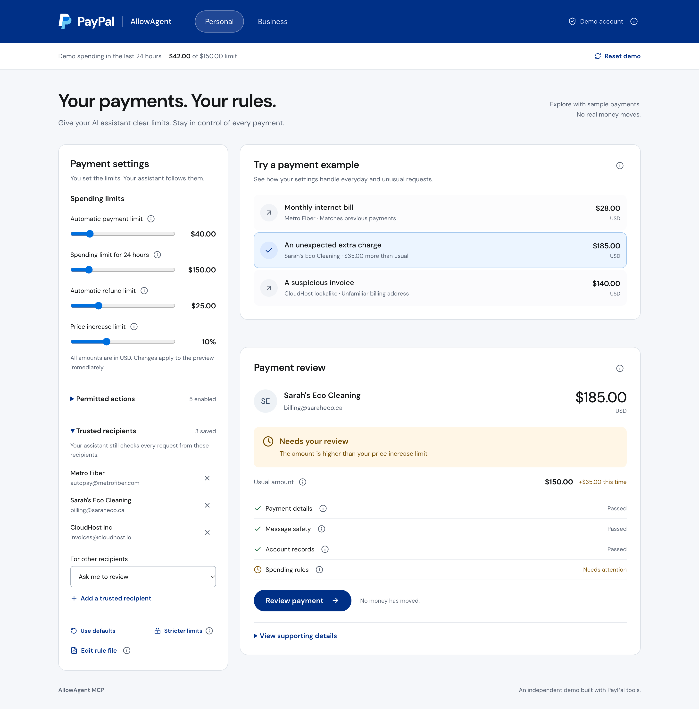

# AllowAgent MCP

AllowAgent is a browser demo for reviewing an AI assistant’s proposed payments. Choose a sample bill or refund to see which account record supports it, which spending rule applies, and what needs your approval. Built independently for the PayPal AI Hackathon.



## Try it locally

Use Node.js 22 and npm. The built-in assistant and sample account work without credentials.

```sh
git clone https://github.com/poferraz/allowagent-mcp.git
cd allowagent-mcp
npm ci
npm run dev
```

Open the URL Vite prints. In **Personal**, select **An unexpected extra charge**. The sample invoice is $185 and the usual charge is $150. **Review payment** opens the comparison and available decisions. Selecting an example only previews it. Choosing an action updates the in-memory demo ledger. **Business** has examples for refunds, disputed deliveries and contractor payments.

## My role

I chose to replace the original developer console with a customer dashboard. I wanted someone reviewing a bill to see the recipient, amount, reason and next action together. The technical evidence is still available on demand. I used AI assistance during development and review. One earlier implementation saved connection credentials across reloads. The dashboard now keeps credentials in memory for the current page. [Dashboard change](https://github.com/poferraz/allowagent-mcp/commit/45b7ce1d5e53685923b5e414edf749e11ea04e52)

## How it works

The assistant proposes an action. TypeScript checks the referenced sample records and the rules in the selected `PAYPAL.md` policy. A request can be eligible, require review, or be blocked. The execution step rechecks the request and allows a single use. The project runs as a React application with locally defined payment-tool schemas. [Sample policies](fixtures/constitutions/) · [Decision logic](src/firewall/) · [Product scope](PRODUCT.md)

**Settings** offers an optional PayPal Sandbox credential check and model connections. The Sandbox connection test contacts PayPal. Dashboard payment and refund actions use the sample ledger. An external model receives the prompt and tool definitions from the browser when you request a proposal. The default reasoner runs locally. [Connections and privacy](SECURITY.md)

Run `npm run verify` and `npm run build` to check a change. [Contributing](CONTRIBUTING.md)

The code uses the MIT licence. The bundled DM Sans fonts use the SIL Open Font License. PayPal names and marks belong to their respective owners. [Code licence](LICENSE) · [Font licence](public/fonts/OFL.txt)
